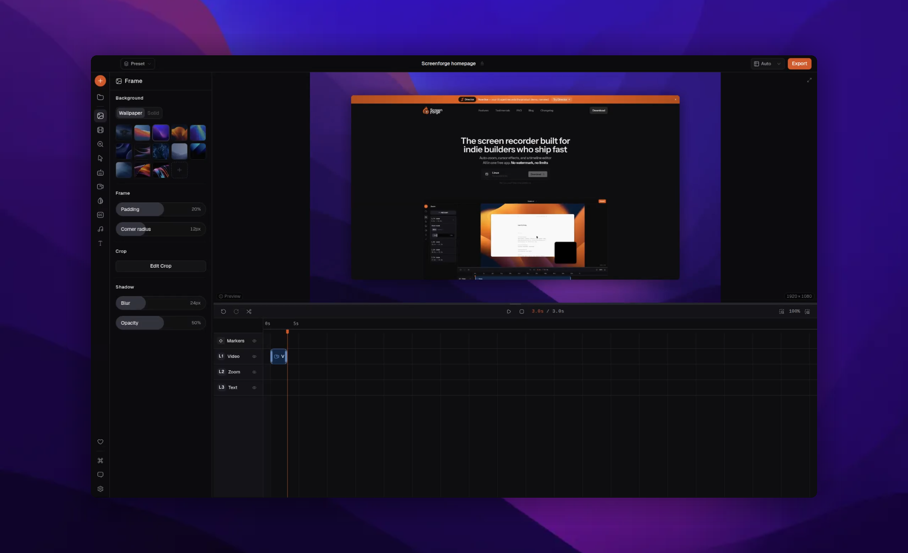

# Screenforge

A free, open-source screen recording tool that automatically zooms and tracks your cursor to create polished screen recordings. No cloud, no subscriptions, no feature gates — everything is processed and stored locally with FFmpeg.

[](./LICENSE)

---

## What it does

Screenforge records your screen (or a window), your webcam, and your mic, then gives you a full local editor to turn that into a polished video — automatic cursor-tracking zoom, camera overlay, captions, and more — before exporting straight to MP4, MOV, WebM, or GIF.

---

## Features

**Recording**
- Full display or individual window capture, with webcam and microphone input
- Cursor tracking (120 Hz, sub-pixel) and per-keystroke input logging, used to drive auto-zoom and the on-screen keyboard overlay

**Editing**
- **Zoom clips** — automatic cursor-tracking zoom or manual keyframed pans, with a cinematic mode (optical zoom, depth, tilt, motion blur, background fade)
- **Cursor styling** — 11 cursor styles, click ripple/sound effects, motion blur, idle-hide
- **Camera overlay** — square/horizontal/vertical shapes, 4 layout presets, background blur/shadow
- **Frame/background** — solid colors, gradients, 14 built-in wallpapers or a custom image, blur, corner radius, shadow
- **Keyboard shortcut overlay** — real-time key press visualization
- **Text clips** — positioned text with full typography controls
- **Privacy masks** — blur or solid-color redaction over arbitrary screen regions
- **Music tracks** — import, loop, trim, volume, fit-to-video
- **Transitions** — 8 types (fade, slide, grow/shrink, blur)
- **Per-clip speed control** — 0.25x–4x
- **Multi-track timeline** — trim, split, and reposition every clip type with waveform visualization

**Captions**
- Local transcription via Whisper (tiny/base/small/medium) over ONNX Runtime — no cloud calls
- Word-level timing, click-to-edit segments, full style customization, SRT export or burned-in captions

**Export**
- MP4, MOV, WebM, GIF at 720p/1080p/4K, 20–60 fps
- Fast/balanced/high quality presets, configurable audio bitrate
- Hidden-window Pixi.js rendering pipeline for frame-accurate, headless export

**Other**
- Teleprompter mode (floating always-on-top window)
- Project library with autosave and style presets (save/reuse cursor, camera, frame, and caption styling together)
- Video import — edit existing MP4/MOV/WebM/AVI/MKV/M4V files, not just fresh recordings
- 7 languages: English, German, Spanish, French, Japanese, Korean, Portuguese
- Optional anonymous usage analytics and error reporting (PostHog) — off in dev builds, no account required

See [`FEATURES.md`](./FEATURES.md) for what's planned next.

---

## Platform support

Officially built and distributed:

- **macOS** (Apple Silicon) — code-signed and notarized
- **Windows** (x64) — Squirrel installer
- **Linux** (x64, preview) — `.deb`, `.rpm`, AppImage and `.zip`, recording on both X11 and Wayland. Still being validated across distros — see [`docs/LINUX_BUILD_PLAN.md`](./docs/LINUX_BUILD_PLAN.md).

---

## Tech stack

| Layer | Technology |
|---|---|
| App framework | Electron 40 + Electron Forge |
| UI | React 19 + Tailwind CSS v4 + Zustand |
| Rendering | Pixi.js (export), Canvas 2D (live preview) |
| Video processing | FFmpeg (local, subprocess) |
| Transcription | Whisper via ONNX Runtime (local) |
| Bundler | Vite |
| Language | TypeScript |

---

## Getting started

**Prerequisites:** Node.js 18+, pnpm 10

```bash
git clone https://github.com/screenforgeai/screenforge.git
cd screenforge
pnpm install
pnpm download:ffmpeg:linux    # Linux only — Windows: pnpm download:ffmpeg:windows
pnpm start
```

### Available commands

```bash
pnpm start        # Start in dev mode (Vite + HMR)
pnpm lint         # Lint TypeScript files
pnpm format       # Prettier write
pnpm test:unit    # Unit tests
pnpm test:export  # Export pipeline tests
pnpm make         # Build distributable installers
```

---

## Contributing

See [`CONTRIBUTING.md`](./CONTRIBUTING.md) for the full setup, testing,
and changeset workflow. This project follows the
[Contributor Covenant](./CODE_OF_CONDUCT.md).

Found a security issue? Please report it privately — see
[`SECURITY.md`](./SECURITY.md).

---

## License

Screenforge is licensed under the
[GNU Affero General Public License v3.0 (or later)](./LICENSE). See
[`THIRD_PARTY_NOTICES.md`](./THIRD_PARTY_NOTICES.md) for third-party
license details (FFmpeg, libuiohook, Whisper).

If Screenforge saves you time, a coffee on [Ko-fi](https://ko-fi.com/mohibarshi) helps keep it going.
